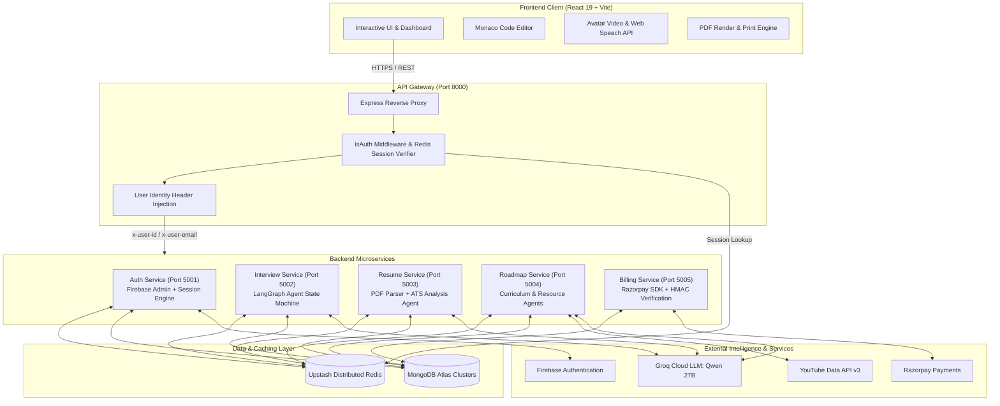
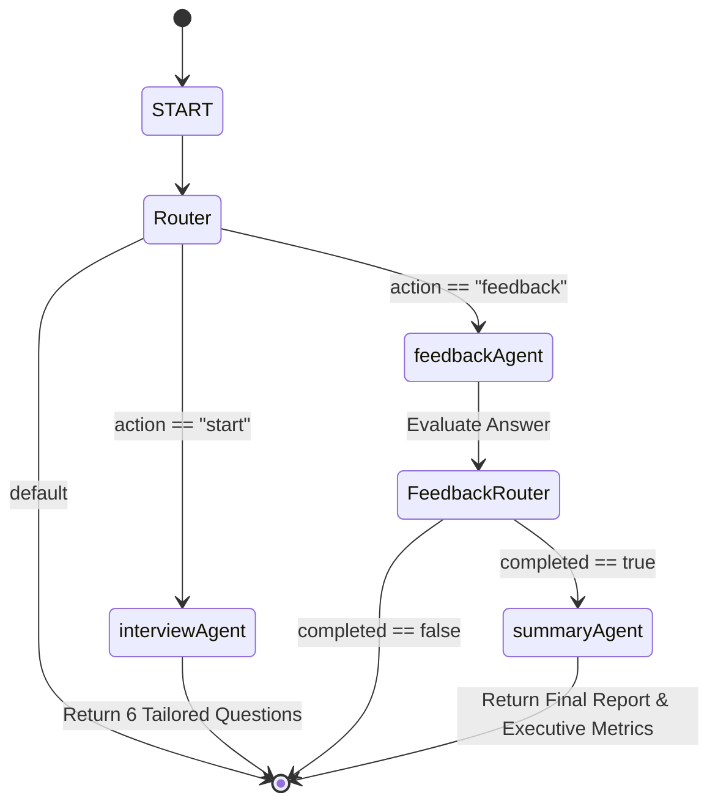

# 🚀 FresherAI — AI-Powered Multi-Agent Career & Interview Platform
  live demo https://fresher-ai-nine.vercel.app/

<p align="center">
  
  
  
  
  
</p>

---

## 🌐 Live Deployments

- **🖥️ Web Application (Frontend):** [https://fresher-ai-nine.vercel.app](https://fresher-ai-nine.vercel.app)
- **🚪 API Gateway:** [https://fresherai-gateway-rqfs.onrender.com](https://fresherai-gateway-rqfs.onrender.com)
- **🗺️ Roadmap Microservice:** [https://fresherai-roadmap-p078.onrender.com](https://fresherai-roadmap-p078.onrender.com)
- **🎙️ Interview Microservice:** [https://fresherai-interview-edv1.onrender.com](https://fresherai-interview-edv1.onrender.com)
- **📄 Resume Microservice:** [https://fresherai-resume-vzqh.onrender.com](https://fresherai-resume-vzqh.onrender.com)
- **💳 Billing Microservice:** [https://fresherai-billing-zlfh.onrender.com](https://fresherai-billing-zlfh.onrender.com)
- **🔐 Auth Microservice:** [https://fresherai-auth-tyq8.onrender.com](https://fresherai-auth-tyq8.onrender.com)

---

## 📖 Table of Contents

1. [Executive Summary](#-executive-summary)
2. [Why FresherAI?](#-why-fresherai)
3. [System Architecture](#-system-architecture)
4. [In-Depth Feature Breakdown](#-in-depth-feature-breakdown)
   - [1. Multi-Agent AI Mock Interview Studio](#1-multi-agent-ai-mock-interview-studio)
   - [2. ATS Resume Scorer & Analyzer](#2-ats-resume-scorer--analyzer)
   - [3. Interactive ATS Resume Builder](#3-interactive-ats-resume-builder)
   - [4. AI Learning Roadmap & Curriculum Generator](#4-ai-learning-roadmap--curriculum-generator)
   - [5. Performance Analytics & Radar Dashboard](#5-performance-analytics--radar-dashboard)
   - [6. Interview Coins Economy & Billing System](#6-interview-coins-economy--billing-system)
   - [7. Authentication & Distributed Session Management](#7-authentication--distributed-session-management)
5. [LangGraph Multi-Agent Workflows](#-langgraph-multi-agent-workflows)
6. [Microservices & API Reference](#-microservices--api-reference)
7. [Database Models & Schemas](#-database-models--schemas)
8. [Tech Stack](#-tech-stack)
9. [Environment Variables Reference](#-environment-variables-reference)
10. [Local Development & Setup Guide](#-local-development--setup-guide)
11. [Docker & Deployment Guide](#-docker--deployment-guide)
12. [Security & Architectural Highlights](#-security--architectural-highlights)

---

## 🌟 Executive Summary

**FresherAI** is an enterprise-grade, multi-agent AI preparation platform engineered specifically for students, fresh engineering graduates, and career transitioners. Traditional interview prep consists of static LeetCode problems or generic question lists that lack dynamic personalization, real-time speech assessment, code execution feedback, and holistic resume-aligned evaluations.

FresherAI solves this by deploying **distributed AI agents** coordinated through **LangGraph** and powered by ultra-low latency **Groq LLMs (`qwen/qwen3.8-27b`)**. Candidates engage in realistic voice- and video-driven interviews with AI avatars, write code in an integrated Monaco Editor, receive instant 8-dimensional performance rubrics, analyze their resumes for Applicant Tracking Systems (ATS), generate ATS-ready resumes, and unlock tailored learning roadmaps linked with curated YouTube tutorials and official developer documentation.

---

## 🎯 Why FresherAI?

| Problem in Traditional Prep | FresherAI Solution |
| :--- | :--- |
| **Static, impersonal questions** from outdated question banks | **Dynamic, resume-aware questioning** tailored to the candidate's exact experience, skills, and target role |
| **No realistic interview pressure** (typing text into ChatGPT) | **Live AI video avatar**, Web Speech voice recognition, live countdown timers, and webcams |
| **Coding separate from verbal answers** | **Integrated in-browser Monaco Code Editor** supporting JavaScript, Python, Java, and C++ with one-click insertion |
| **Subjective, vague feedback** ("Good job!") | **Multi-agent 8-axis scoring rubric** (Correctness, Clarity, Relevance, Detail, Efficiency, Communication, Problem Solving, Creativity) |
| **Disconnect between resume and preparation** | **Unified data pipeline** where ATS resume analysis directly feeds into interview simulations and learning roadmaps |
| **Lack of structured upskilling** | **AI Roadmap Generator** that plans milestones based on target compensation tiers (10 LPA - 40 LPA) with YouTube & official docs |

---

## 🏗️ System Architecture

FresherAI is architected as an event-driven, decoupled **Microservices Ecosystem** connected through a high-performance **API Gateway**:



---

## 🔬 In-Depth Feature Breakdown

### 1. Multi-Agent AI Mock Interview Studio

The flagship feature of FresherAI replicates the high-stakes environment of FAANG and top tech interviews with an interactive, multi-modal simulation:

#### A. Interview Modes
- **Technical Interviews:** Rigorous exploration of algorithms, data structures, system design, architectural trade-offs, language internals, and live coding exercises.
- **HR & Behavioral Interviews:** Evaluates leadership qualities, team conflict handling, STAR method articulation, situational judgment, and workplace culture alignment.

#### B. Realistic AI Interviewer Video Avatar
- Candidates interact with an animated **Male or Female AI Interviewer** video avatar.
- Video playback synchronized with browser speech synthesis (Web Speech API) simulating natural interview cadence.
- Candidates can toggle their own live **webcam video stream** to practice maintaining professional eye contact and posture.

#### C. Real-Time Speech Recognition (STT) & Audio
- Uses browser-native **Web Speech Recognition (`webkitSpeechRecognition`)**.
- Speech is transcribed into text in real-time as the candidate talks, eliminating tedious typing while practicing verbal delivery.
- Quick microphone mute/unmute and speech toggle controls.

#### D. Built-in Multi-Language Monaco Code Editor
- In-browser code editor powered by **Monaco Editor** (the engine behind VS Code).
- Supports 4 major industry programming languages: **JavaScript**, **Python**, **Java**, and **C++**.
- Features customizable themes, syntax validation, indentation, line numbering, and bracket pairing.
- **"Add to Answer"** button instantly integrates the candidate's code solution alongside their verbal explanation.

#### E. Timed Question Cycles & Dynamic Difficulty
- Each question is dynamically tagged as `easy`, `medium`, or `hard`.
- Real-time countdown timer automatically adjusts to question complexity (e.g., 60s to 180s).
- Candidates can submit answers or request extensions before time expires.

#### F. Resume-Informed Questioning
- When the candidate checks **"Use Resume"**, the AI analyzes their parsed resume details (skills, projects, work experience, missing skills) to ask tailored, probing questions (e.g., *"In your e-commerce project, why did you pick Redis over Memcached for caching?"*).

#### G. Post-Interview Report & PDF Export
- Once completed, the session produces an executive report displaying:
  - **Overall Score (0-100)**
  - Total questions attempted and completion badges
  - **Executive Summary** synthesizing overall performance
  - Detailed list of **Strengths** (e.g., clear architectural explanation, good algorithmic complexity analysis)
  - Detailed list of **Weaknesses** (e.g., missed edge cases, rambling introductions)
  - Concrete **Actionable Recommendations**
  - Per-question breakdown showing candidate answer, question difficulty, and score
  - **Export to PDF:** Instant formatted document generation via `react-to-print`.

---

### 2. ATS Resume Scorer & Analyzer

Getting past Applicant Tracking Systems (ATS) is often the highest barrier for new candidates. FresherAI provides an automated audit engine:

- **PDF Ingestion & Text Extraction:** Files uploaded via Multer are parsed into clean text using `pdf-parse`.
- **Intelligent Field Extraction:** The LLM extracts:
  - Candidate details (Full Name, Email, Phone)
  - Professional Summary
  - Technical Skills inventory
  - Academic Qualifications & Degrees
  - Work Experience & Projects
- **ATS Compatibility Score:** Generates an ATS benchmark score (0-100) rendered as an interactive radial progress ring via Recharts.
- **Gap & Vulnerability Detection:**
  - **Strengths:** Highlighting strong keywords and quantified impact statements.
  - **Weaknesses:** Pinpointing passive voice, lack of metrics, or vague bullet points.
  - **Missing Skills:** Detecting industry-standard tools required for the candidate's target role that are missing from their CV.
  - **Suggested Job Roles:** Algorithmic matching suggesting best-fit entry-level positions.
  - **Tailored Recommendations:** Specific edits to boost ATS pass rates.
- **Distributed Cache Integration:** The analyzed profile is cached in Redis (`resume:<userId>`) and saved to MongoDB so other microservices (Roadmap & Interview) can access it instantly without re-uploading.

---

### 3. Interactive ATS Resume Builder

For candidates starting from scratch or redesigning their resumes, FresherAI offers a 6-step guided resume studio:

1. **Step 1 — Personal Information:** Name, email, phone, location, LinkedIn, GitHub, and portfolio links.
2. **Step 2 — Professional Summary:** Structured guidance to write an impactful, concise 3-4 sentence elevator pitch.
3. **Step 3 — Technical Skills:** Categorized breakdown covering programming languages, frameworks, libraries, tools, and databases.
4. **Step 4 — Work Experience:** Company name, role title, duration, location, and bulleted achievements.
5. **Step 5 — Projects:** Project name, technology stack used, live demo links, source code, and key features.
6. **Step 6 — Education:** Institution, degree, major, graduation year, and GPA/percentage.

#### Features:
- **Clean Single-Column ATS Layout:** Pre-configured typography, margins, and hierarchy designed to guarantee 99%+ parsing accuracy across Workday, Greenhouse, Lever, and Taleo.
- **Responsive Live Preview:** Live scaling engine adapting to viewport dimensions from mobile to 4K displays.
- **Direct PDF Export:** Generates clean, vector-crisp PDFs ready for job applications.

---

### 4. AI Learning Roadmap & Curriculum Generator

FresherAI bridges knowledge gaps with customized learning roadmaps:

- **Target-Driven Generation:** Candidates supply their desired role (e.g., *Full Stack Developer*, *DevOps Engineer*, *Data Engineer*) and their target salary tier:
  - `10 LPA`, `15 LPA`, `20 LPA`, `30 LPA`, `40 LPA`
- **Resume-Aware Delta Planning:** Cross-references the candidate's verified resume skills against the target package requirements, automatically focusing modules on missing competencies.
- **Multi-Agent Resource Curation:**
  - **Roadmap Agent:** Structures chronological modules, milestone durations, and progressive difficulty tiers (`Easy`, `Medium`, `Hard`).
  - **Resource Agent:** Integrates with the **YouTube Data API v3** to search and attach the highest-rated tutorial videos for every module, plus links to official developer documentation.
- **Expandable Accordion Interface:** Candidates can expand each module card to view topic summaries, launch video tutorials, and read documentation.
- **History & Progress Storage:** Roadmaps are persisted in MongoDB and cached in Redis for immediate retrieval on the dashboard.

---

### 5. Performance Analytics & Radar Dashboard

The candidate command center provides real-time visibility into interview readiness:

- **Executive KPI Cards:**
  - Total Interviews Conducted
  - Total Questions Answered
  - Completed Interview Sessions
  - Cumulative Average Readiness Score (0-100)
- **Multi-Dimensional Polar Radar Charts (Recharts):**
  - **Technical Interview Radar:** Maps average performance across 8 distinct competency axes:
    1. *Correctness*
    2. *Clarity*
    3. *Relevance*
    4. *Detail*
    5. *Efficiency*
    6. *Communication*
    7. *Problem Solving*
    8. *Creativity*
  - **HR Interview Radar:** Visualizes interpersonal and behavioral metrics.
- **Interview History & Resumption:** Direct access to past interview sessions and generated reports.

---

### 6. Interview Coins Economy & Billing System

FresherAI features a transparent credit-based microtransaction economy:

#### Credit Consumption Rates:
| Action | Coin Cost |
| :--- | :---: |
| **New User Registration Allotment** | `+150 Coins (Free)` |
| **Resume ATS Analysis & Scoring** | `10 Coins` |
| **Resume PDF Download** | `10 Coins` |
| **Roadmap Generation** | `20 Coins` |
| **Full AI Mock Interview Session** | `50 Coins` |

#### Razorpay Billing Integration:
- **Order Generation:** Gateway routes checkout request to Billing service, creating a verified Razorpay order in INR.
- **Modal Checkout:** Seamless Razorpay payment popup supporting UPI, Cards, NetBanking, and Wallets.
- **Server-Side Cryptographic Verification:** Billing service validates `razorpay_signature` using HMAC-SHA256 with the secret key.
- **Instant Distributed Credit:** Validated payments immediately credit coins to MongoDB and update the Redis session in real-time.

---

### 7. Authentication & Distributed Session Management

Security and low-latency authorization are fundamental to FresherAI:

- **Firebase Google OAuth:** Fast, secure client-side sign-in popup.
- **Server Token Validation:** Firebase Admin SDK verifies identity tokens on the Auth microservice.
- **Distributed Redis Sessions:**
  - Generates secure cryptographic UUID session tokens.
  - Stores session payloads (user ID, name, email, coins) in Upstash Redis with a 7-day TTL (`EX 604800`).
  - Sets HTTP-Only, Secure, SameSite=None cookies to prevent XSS and session hijacking.
- **Gateway Reverse Proxy with Header Forwarding:**
  - The API Gateway executes the `isAuth` middleware on protected routes.
  - Validates the Redis session in under 5ms.
  - Injects `x-user-id`, `x-user-email`, and user details into downstream request headers (`proxyWithHeaders`).
  - Downstream microservices remain stateless and decoupled from session storage logic.

---

## 🤖 LangGraph Multi-Agent Workflows

FresherAI implements **StateGraph** from `@langchain/langgraph` to coordinate multiple AI agents during interviews:



### Agent Roles:
1. **`interviewAgent` (Question Generator):**
   - Ingests role, interview type (HR vs Technical), and candidate resume.
   - Generates exactly 6 calibrated questions with difficulty tiers and countdown timers.
2. **`feedbackAgent` (Real-Time Evaluator):**
   - Evaluates answers against 8 independent dimensions with scores (0-100).
   - Generates natural, constructive critique highlighting missing points without sounding robotic.
3. **`summaryAgent` (Synthesis Agent):**
   - Activated after the 6th question.
   - Calculates aggregate score, identifies overarching candidate strengths and weaknesses, and produces targeted recommendations.

---

## 📡 Microservices & API Reference

All requests route through the **API Gateway** (`http://localhost:8000` or production URL).

### 1. API Gateway Endpoints
| Method | Route | Auth Required | Description |
| :--- | :--- | :---: | :--- |
| `GET` | `/` | No | Gateway health check |
| `GET` | `/api/me` | Yes | Retrieves current authenticated user session |

---

### 2. Auth Service (`/api/auth`)
| Method | Route | Description |
| :--- | :--- | :--- |
| `POST` | `/api/auth/login` | Verifies Firebase token, creates user in MongoDB, initializes Redis session |
| `GET` | `/api/auth/logout` | Clears Redis session and unsets session cookie |
| `POST` | `/api/auth/use-coins` | Deducts coins from user balance for platform actions |
| `POST` | `/api/auth/add-coins` | Adds coins to user balance following successful payment verification |

---

### 3. Interview Service (`/api/interview`)
| Method | Route | Description |
| :--- | :--- | :--- |
| `POST` | `/api/interview/start` | Initializes new interview session via LangGraph `interviewAgent` |
| `POST` | `/api/interview/submit-answer` | Submits candidate answer, returns real-time feedback or final summary |
| `GET` | `/api/interview/all` | Retrieves user's complete interview history, aggregated stats, and radar data |
| `GET` | `/api/interview/:id` | Fetches details and questions for a specific interview session |

---

### 4. Resume Service (`/api/resume`)
| Method | Route | Description |
| :--- | :--- | :--- |
| `POST` | `/api/resume/upload` | Ingests PDF resume (multipart/form-data), parses text, runs ATS analysis |
| `GET` | `/api/resume/get` | Fetches cached or stored resume analysis for the authenticated user |

---

### 5. Roadmap Service (`/api/roadmap`)
| Method | Route | Description |
| :--- | :--- | :--- |
| `POST` | `/api/roadmap/generate` | Generates personalized learning roadmap + fetches YouTube tutorials & articles |
| `GET` | `/api/roadmap/all` | Retrieves all previously generated roadmaps for the user |
| `GET` | `/api/roadmap/:id` | Fetches details of a specific roadmap |

---

### 6. Billing Service (`/api/billing`)
| Method | Route | Description |
| :--- | :--- | :--- |
| `POST` | `/api/billing/create` | Generates a new Razorpay payment order for a selected coin package |
| `POST` | `/api/billing/verify` | Validates HMAC-SHA256 signature and marks payment as paid |

---

## 🗄️ Database Models & Schemas

### User Schema (`backend/services/auth/model/user.model.js`)
```javascript
{
  firebaseUid: { type: String, required: true, unique: true },
  email:       { type: String, required: true, unique: true },
  name:        { type: String, required: true },
  interviewCoin: { type: Number, default: 150 }, // Starting free credit
  timestamps:  true
}
```

### Interview Schema (`backend/services/interview/models/interview.model.js`)
```javascript
{
  userId:          { type: ObjectId, required: true, index: true },
  type:            { type: String, enum: ["hr", "technical"], required: true },
  role:            { type: String, required: true },
  useResume:       { type: Boolean, default: false },
  currentQuestion: { type: Number, default: 0 },
  questions: [
    {
      question:   String,
      userAnswer: String,
      difficulty: { type: String, enum: ["easy", "medium", "hard"] },
      timer:      Number,
      feedback: {
        score: Number,
        correctness: Number,
        clarity: Number,
        relevance: Number,
        detail: Number,
        efficiency: Number,
        communication: Number,
        problemSolving: Number,
        creativity: Number,
        feedback: String,
        improvements: [String]
      }
    }
  ],
  overallScore:    Number,
  strengths:       [String],
  weaknesses:      [String],
  recommendations: [String],
  summary:         String,
  status:          { type: String, enum: ["in-progress", "completed"], default: "in-progress" },
  timestamps:      true
}
```

### Resume Schema (`backend/services/resume/models/resume.model.js`)
```javascript
{
  userId:          { type: ObjectId, required: true, index: true },
  extractedText:   String,
  name:            String,
  email:           String,
  phone:           String,
  summary:         String,
  skills:          [String],
  projects:        [Object],
  education:       [Object],
  experience:      [Object],
  strengths:       [String],
  weaknesses:      [String],
  missingSkills:   [String],
  suggestedRole:   String,
  score:           Number, // ATS Score (0-100)
  recommendations: [String],
  timestamps:      true
}
```

### Roadmap Schema (`backend/services/roadmap/models/roadmap.model.js`)
```javascript
{
  userId:        { type: ObjectId, required: true, index: true },
  title:         String,
  role:          String,
  targetPackage: String, // e.g. "20 LPA"
  level:         String, // "Beginner", "Intermediate", "Advanced"
  duration:      String, // e.g. "3 Months"
  modules: [
    {
      title:       String,
      description: String,
      duration:    String,
      difficulty:  String,
      youtube:     String, // Curated video tutorial URL
      article:     String  // Curated documentation link
    }
  ],
  timestamps:    true
}
```

### Billing Schema (`backend/services/billing/models/billing.model.js`)
```javascript
{
  userId:            { type: ObjectId, required: true, index: true },
  amount:            Number,
  interviewCoins:    Number,
  razorpayOrderId:   String,
  razorpayPaymentId: String,
  razorpaySignature: String,
  status:            { type: String, enum: ["created", "paid", "failed"], default: "created" },
  timestamps:        true
}
```

---

## 💻 Tech Stack

### Client Layer
- **Core:** React 19, Vite 6, HTML5, Vanilla / Tailwind CSS
- **State Management:** Redux Toolkit (`@reduxjs/toolkit`), React Redux
- **Routing:** React Router v7 (`react-router-dom`)
- **Animation & Transitions:** Framer Motion (`motion/react`)
- **Visualizations:** Recharts (RadialBarChart, RadarChart, PolarAngleAxis, PolarGrid)
- **Code Editor:** Monaco Editor (`@monaco-editor/react`)
- **Document Rendering:** React to Print (`react-to-print`)
- **Icons:** React Icons (`react-icons/fi`, `react-icons/fa6`, `react-icons/fc`, `react-icons/gi`, `react-icons/bs`)
- **HTTP Client:** Axios with credential / cookie forwarding

### Microservices & Server Layer
- **Runtime:** Node.js (v18+)
- **Web Framework:** Express.js
- **Reverse Proxy:** `express-http-proxy`
- **File Ingestion:** Multer (Memory & Disk storage for PDFs)
- **PDF Extraction:** `pdf-parse`
- **Logging & Utilities:** Morgan, Cookie-Parser, CORS, Dotenv

### AI & Agent Orchestration
- **Agent Framework:** `@langchain/langgraph` (StateGraph, Conditional Edges, Nodes)
- **Core LLM Abstractions:** `@langchain/core` (SystemMessage, HumanMessage)
- **LLM Provider:** `@langchain/groq`
- **Model:** `qwen/qwen3.8-27b` (optimized for fast reasoning and structured JSON output)

### Databases & Cloud Infrastructure
- **Persistent Database:** MongoDB Atlas with Mongoose ODM
- **In-Memory Cache & Session Store:** Upstash Redis with IORedis (TLS encryption)
- **Authentication Provider:** Firebase Authentication & Firebase Admin SDK
- **Payment Processing:** Razorpay Node.js SDK & Checkout.js
- **External Video Data:** YouTube Data API v3

---

## 🔐 Environment Variables Reference

Create `.env` files in each service directory according to the specifications below:

### 1. `backend/gateway/.env`
```env
PORT=8000
FRONTEND_URL="http://localhost:5173"
REDIS_URL="rediss://default:<password>@<host>.upstash.io:6379"

AUTH_SERVICE_URL="http://localhost:5001"
RESUME_SERVICE_URL="http://localhost:5003"
INTERVIEW_SERVICE_URL="http://localhost:5002"
ROADMAP_SERVICE_URL="http://localhost:5004"
BILLING_SERVICE_URL="http://localhost:5005"
```

### 2. `backend/services/auth/.env`
```env
PORT=5001
MONGO_URI="mongodb+srv://<username>:<password>@cluster.mongodb.net/fresherai_auth"
REDIS_URL="rediss://default:<password>@<host>.upstash.io:6379"
```
*(Also place your `serviceAccountKey.json` from Firebase Console in `backend/services/auth/`)*

### 3. `backend/services/interview/.env`
```env
PORT=5002
MONGO_URI="mongodb+srv://<username>:<password>@cluster.mongodb.net/fresherai_interview"
REDIS_URL="rediss://default:<password>@<host>.upstash.io:6379"
GROQ_API_KEY="gsk_..."
```

### 4. `backend/services/resume/.env`
```env
PORT=5003
MONGO_URI="mongodb+srv://<username>:<password>@cluster.mongodb.net/fresherai_resume"
REDIS_URL="rediss://default:<password>@<host>.upstash.io:6379"
GROQ_API_KEY="gsk_..."
```

### 5. `backend/services/roadmap/.env`
```env
PORT=5004
MONGO_URI="mongodb+srv://<username>:<password>@cluster.mongodb.net/fresherai_roadmap"
REDIS_URL="rediss://default:<password>@<host>.upstash.io:6379"
GROQ_API_KEY="gsk_..."
YOUTUBE_API_KEY="AIzaSy..."
```

### 6. `backend/services/billing/.env`
```env
PORT=5005
MONGO_URI="mongodb+srv://<username>:<password>@cluster.mongodb.net/fresherai_billing"
REDIS_URL="rediss://default:<password>@<host>.upstash.io:6379"
RAZORPAY_KEY_ID="rzp_test_..."
RAZORPAY_KEY_SECRET="..."
```

### 7. `frontend/.env`
```env
VITE_BACKEND_URL="http://localhost:8000"
VITE_FIREBASE_APIKEY="AIzaSy..."
VITE_RAZORPAY_KEY_ID="rzp_test_..."
```

---

## 🛠️ Local Development & Setup Guide

### Prerequisites
- **Node.js:** v18.0.0 or higher
- **Package Manager:** npm or yarn
- **Git**
- **MongoDB Atlas** account (or local MongoDB)
- **Upstash Redis** account (or local Redis instance)
- **Groq Cloud API Key** ([console.groq.com](https://console.groq.com))
- **Firebase Project** with Google Authentication enabled
- **Razorpay Test Account** ([dashboard.razorpay.com](https://dashboard.razorpay.com))
- **Google Cloud YouTube Data API v3 Key**

### 1. Clone the Repository
```bash
git clone https://github.com/AnkitRaj154760/Fresher-ai.git
cd Fresher-ai
```

### 2. Install Dependencies
Run npm install across the gateway, frontend, and microservices:

```bash
# Install Gateway dependencies
cd backend/gateway && npm install && cd ../..

# Install Microservices dependencies
cd backend/services/auth && npm install && cd ../../..
cd backend/services/interview && npm install && cd ../../..
cd backend/services/resume && npm install && cd ../../..
cd backend/services/roadmap && npm install && cd ../../..
cd backend/services/billing && npm install && cd ../../..

# Install Frontend dependencies
cd frontend && npm install && cd ..
```

### 3. One-Click Launch (Windows PowerShell)
FresherAI includes an automated orchestrator script that spins up all 7 services in separate dedicated terminal windows:

```powershell
.\start.ps1
```

Once launched:
- 🌐 **Frontend Client:** [http://localhost:5173](http://localhost:5173)
- 🚪 **Gateway Proxy:** [http://localhost:8000](http://localhost:8000)

---

## 🐳 Docker & Deployment Guide

Each microservice and the API Gateway include containerization manifests (`Dockerfile`):

### Example Service Dockerfile
```dockerfile
FROM node:18-alpine
WORKDIR /app
COPY package*.json ./
RUN npm install --omit=dev
COPY . .
EXPOSE 5002
CMD ["npm", "start"]
```

### Production Deployment Strategy:
- **Frontend:** Deployed to **Vercel** with single-page application (SPA) routing rewrites (`vercel.json`).
- **Backend Microservices:** Deployed on **Render** (as individual Web Services or Docker containers).
- **Session Layer:** Managed serverless **Upstash Redis** providing global low-latency session reads.
- **Data Persistence:** **MongoDB Atlas** multi-region clusters.

---

## 🛡️ Security & Architectural Highlights

1. **Decoupled Stateless Services:** Microservices do not directly touch session cookies; the Gateway verifies credentials against Redis and forwards authenticated metadata via `x-user-id` and `x-user-email` headers.
2. **Secure Cross-Site Cookies:** Cookies are configured with `HttpOnly: true`, `Secure: true`, and `SameSite: "none"` to guarantee protection against Cross-Site Scripting (XSS) while enabling cross-domain deployment between Vercel and Render.
3. **Cryptographic Payment Validation:** Payments cannot be tampered with on the client side; signatures are recomputed and verified using HMAC-SHA256 with the secret key before coins are credited.
4. **Temporary File Life-Cycle:** Resumes uploaded for ATS analysis are parsed in memory / temporary directories and immediately deleted (`fs.unlinkSync`) following analysis to protect candidate privacy.
5. **High-Resilience Redis Caching:** Frequently accessed data (interview history, ATS resume analysis, roadmaps) is served directly from Redis cache, reducing MongoDB read load and cutting response times to under 10ms.

---

## 👥 Contributors & Acknowledgements

Created with passion by **Ankit Raj** ([@AnkitRaj154760](https://github.com/AnkitRaj154760)).

Special thanks to:
- **LangChain & LangGraph** for multi-agent state orchestration.
- **Groq Cloud** for blazing-fast open-weight LLM inference.
- **Monaco Editor** & **Recharts** teams for developer tooling and visualization primitives.

---

## 📄 License

This project is licensed under the **MIT License**. You are free to use, modify, and distribute this software for personal and commercial purposes.
